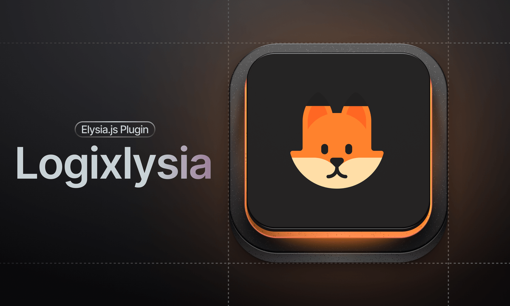

<div align="center">
  <h1><code>🦊</code> Logixlysia</h1>
  <strong>Logixlysia is a logging library for ElysiaJS</strong>
  
</div>

## `📩` Installation

```bash
bun add logixlysia
```

## `📝` Usage

Add the plugin, then log from a handler with `log`. Fields you add with `log.mergeContext` land on that request's access line.

```ts
import { Elysia } from 'elysia'
import logixlysia from 'logixlysia'

new Elysia()
  .use(logixlysia())
  .get('/users/:id', ({ log, params }) => {
    log.mergeContext({ userId: params.id })
    return { id: params.id }
  })
  .listen(3000)
```

`GET /users/42` prints this when the output is piped or colors are off:

```
2026-11-12T05:54:29.847Z INFO  GET     /users/42 200 1ms
  └─ userId  42
```

### Configuration

```ts
import { Elysia } from 'elysia'
import logixlysia from 'logixlysia' // or import { logixlysia } from 'logixlysia'

const app = new Elysia({
  name: 'Elysia with Logixlysia'
})
  .use(
    logixlysia({
      config: {
        service: 'api-server',
        showStartupMessage: true,
        startupMessageFormat: 'banner',
        showContextTree: true,
        contextDepth: 2,
        slowThreshold: 500,
        verySlowThreshold: 1000,
        timestamp: {
          translateTime: 'yyyy-mm-dd HH:MM:ss.SSS'
        },
        ip: true
      }
    })
  )
  .get('/', () => {
    return { message: 'Welcome to Basic Elysia with Logixlysia' }
  })

app.listen(3000)
```

#### Choosing which routes are logged

`logFilter` takes path globs, so health checks and static assets stay out of your logs. A request whose pathname matches `exclude`, or misses a non-empty `include`, writes nothing: no access line, no `log.*` lines from its handler, no error line, no WebSocket lines. `exclude` wins over `include`. `**` crosses `/`; `*` and `?` do not.

```ts
logixlysia({
  config: {
    logFilter: {
      include: ['/api/**'],
      exclude: ['/api/internal/**']
    }
  }
})
```

## `✨` Features

- **Request context**: accumulate fields with `mergeContext` into a context tree. [Docs](https://logixlysia.vercel.app/docs/features/request-context)
- **Presets**: `dev`, `prod`, and `json` output. [Docs](https://logixlysia.vercel.app/docs/configuration)
- **File logging**: writes to disk with rotation by size, age, or count. [Docs](https://logixlysia.vercel.app/docs/features/file-logging)
- **Adapters**: nine built-in destinations, Axiom, Better Stack, ClickHouse, Datadog, HyperDX, Loki, OTLP, PostHog, and Sentry. [Docs](https://logixlysia.vercel.app/docs/adapters/overview)
- **Sampling**: head and tail sampling controls log volume. [Docs](https://logixlysia.vercel.app/docs/features/sampling)
- **Enrichers**: add trace, user agent, geo, and size fields to every request. [Docs](https://logixlysia.vercel.app/docs/features/enrichers)
- **Redaction**: `autoRedact` masks PII by pattern; `logixlysia/desertant` adds neural redaction. [Config docs](https://logixlysia.vercel.app/docs/configuration#autoredact), [Neural redaction docs](https://logixlysia.vercel.app/docs/integrations/desertant)
- **Structured errors**: `HttpError` carries `why`, `fix`, and `link`. [Docs](https://logixlysia.vercel.app/docs/api-reference)
- **Request IDs**: read from the incoming request or generated, when `requestId` is on (the `prod` preset turns it on). [Docs](https://logixlysia.vercel.app/docs/features/request-id)
- **OpenTelemetry**: trace correlation and AI usage metrics on the access log. [Docs](https://logixlysia.vercel.app/docs/integrations/otel)
- **WebSocket logging**: lifecycle logs via `wrapWs`. [Docs](https://logixlysia.vercel.app/docs/features/websocket)

## `📚` Documentation

Check out the [website](https://logixlysia.vercel.app) for more detailed documentation and examples.

Using a coding agent? The repo ships an [agent skill](https://github.com/PunGrumpy/logixlysia/blob/main/skills/logixlysia/SKILL.md) with the API and conventions.

## `📄` License

Licensed under the [MIT License](LICENSE).
